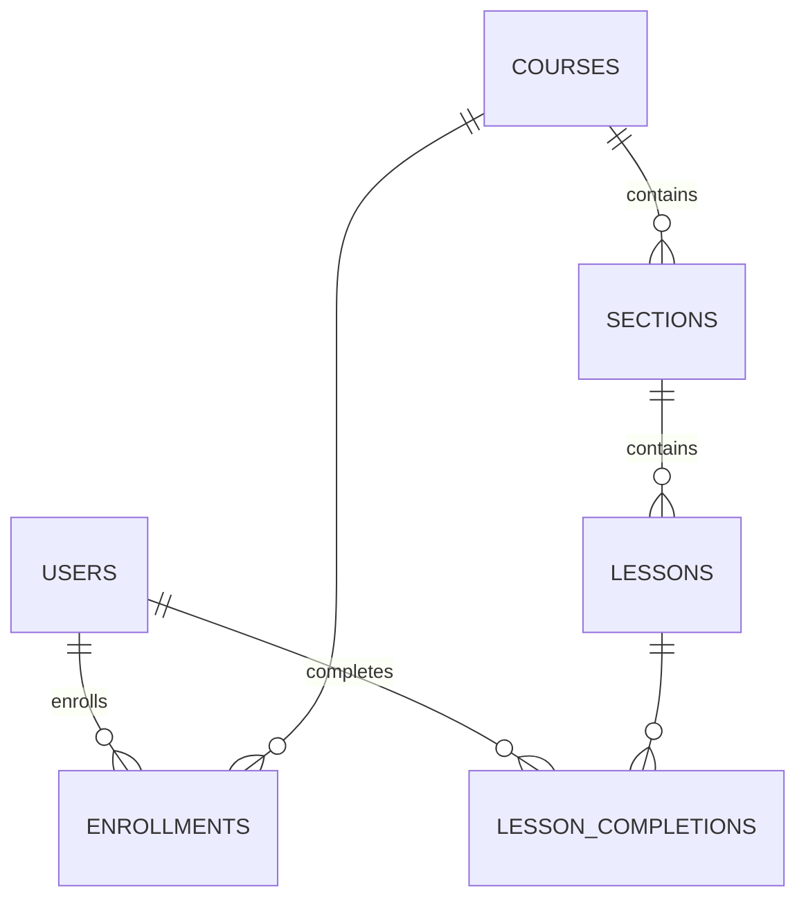

# Course Platform

[](https://github.com/rupinski75/course-platform/actions/workflows/ci.yml)

A work in progress simple course platform which is created to present [App Academy Open Ruby & Rails courses](https://github.com/rupinski75/aa-public-ruby-curriculum) which are no longer available in a hosted version.

## Demo

Live at https://learn.rupinski.pl

| Role | Email | Password |
|------|-------|----------|
| Student | student@demo | demopass123 |
| Admin | admin@demo | demopass123 |

## How it works

- Two Devise User roles: admin, student. Admin can CRUD courses, sections and lessons. Student can enroll and mark lessons as done/undone.
- Courses have sections, sections have lessons, shallow routes keep URLs short.
- Enrollment and lesson completion are join tables with unique pair indexes, duplicates are rejected by the database.
- Progress is calculated by two count queries: lessons completions > lessons > sections, joined per course for a user.

## Stack

* Ruby 4.0.10, Rails 8.1, PostgreSQL, Tailwind, Hotwire, Devise, RSpec.
* CI on GitHub Actions with default checks (brakeman, bundler-audit, importmap audit, rubocop) and RSpec specs.
* Deployed with Kamal to Docker, behind a TLS reverse proxy with Let's Encrypt certificate.

## Schema



## Run locally

```bash
docker compose up -d
bin/rails db:prepare
bin/rails server
```
## TODO and next steps
- [ ] Dashboard listing enrolled courses and their progress
- [ ] Continue button jumping to the first unfinished lesson of a course
- [ ] Next-lesson link on the lesson page, first unfinished in order
- [ ] Streak counter
- [ ] Lesson content rendered as Markdown to import AAO Curriculum
- [ ] Import real content
- [ ] Better layout and design 
